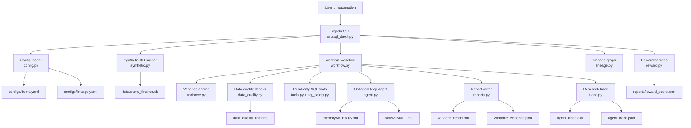
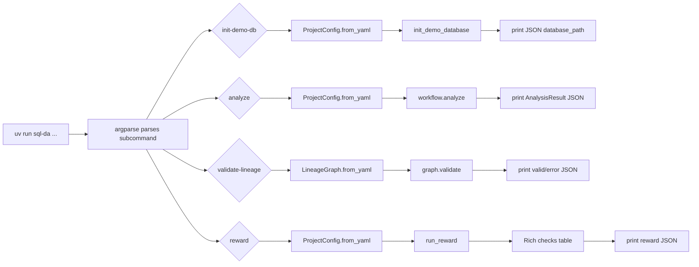
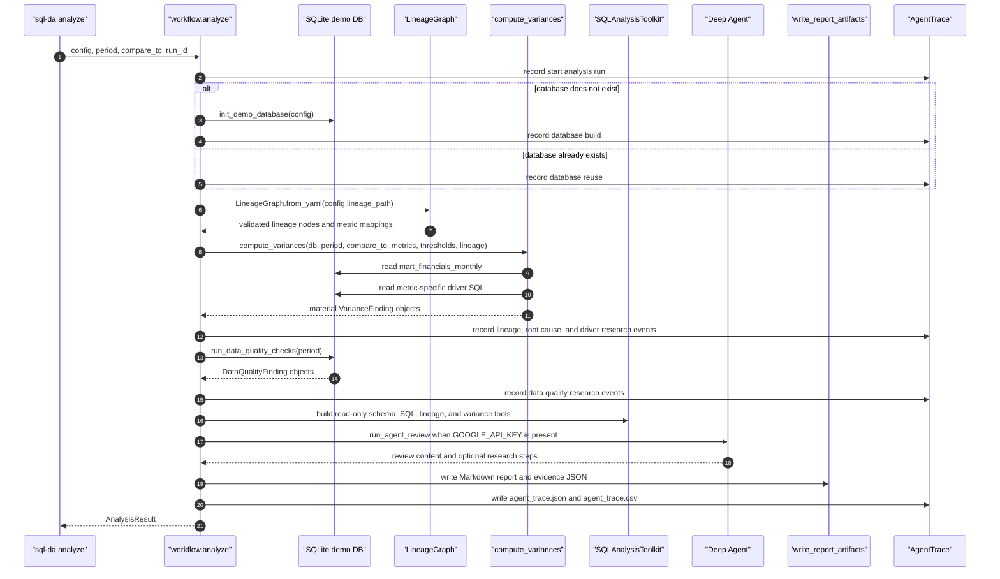
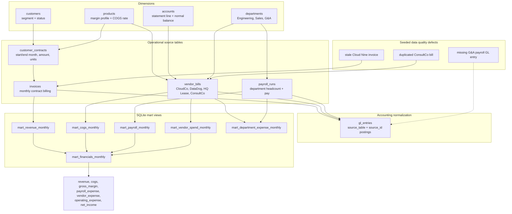
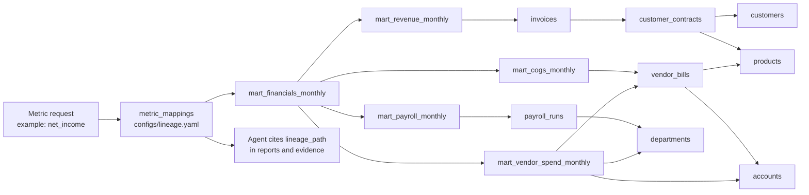
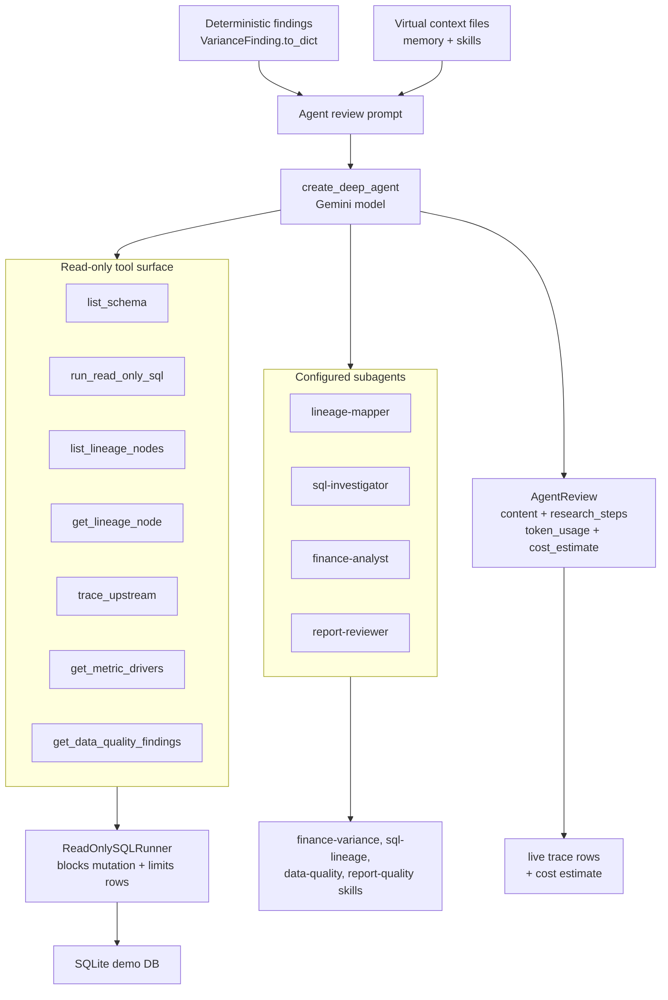
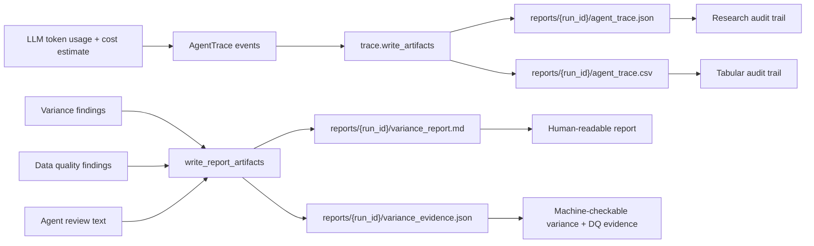
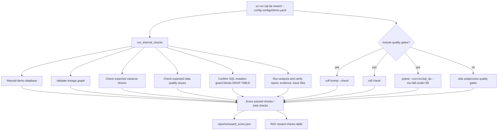

# SQL Deep Agent Synthetic Finance Variance Analyzer

This repo demonstrates a SQL deep agent for finance variance analysis. It builds a deterministic synthetic SQLite database, stores database lineage in YAML, computes month-over-month variance candidates and data-quality findings with deterministic SQL, and optionally asks a LangChain Deep Agent backed by Google Gemini to investigate and review the report.

## Setup

```bash
uv venv
uv sync
uv pip install .
```

The repo includes `.python-version` so `uv venv` uses the uv-managed CPython 3.13 line instead of a conda interpreter. The explicit `uv pip install .` keeps the `sql-da` console script reliable in environments where editable-install `.pth` files are not processed.

Add your Gemini key to `.env` after setup:

```bash
GOOGLE_API_KEY=your-key-here
SQL_DA_MODEL=google_genai:gemini-3-flash-preview
```

The default Gemini development model is `google_genai:gemini-3-flash-preview`. The underlying Gemini API model code is `gemini-3-flash-preview`.

Customize LangChain `ChatGoogleGenerativeAI` construction in `configs/demo.yaml` under `model.args`. The top-level `model.name` remains the model id and `model.temperature` remains the default temperature unless `model.args.temperature` is set:

```yaml
model:
  name: google_genai:gemini-3-flash-preview
  temperature: 0.0
  enable_live_agent: true
  args:
    top_p: 0.95
    top_k: 40
    max_tokens: 4096
    request_timeout: 120
    retries: 3
    thinking_budget: 1024
```

LLM cost estimates use the Gemini API paid-tier standard text token rates for `gemini-3-flash-preview` from the [Google AI for Developers pricing page](https://ai.google.dev/gemini-api/docs/pricing), last updated there on 2026-04-22: $0.50 per 1M input tokens, $3.00 per 1M output tokens, and $0.05 per 1M cached input tokens. Estimates depend on provider token metadata and exclude free-tier credits, taxes, and non-token tool fees.

## Run The Demo

```bash
uv run sql-da init-demo-db --config configs/demo.yaml
uv run sql-da validate-lineage --lineage configs/lineage.yaml
uv run sql-da analyze --config configs/demo.yaml --period 2026-03 --compare-to 2026-02 --verbose
```

The analysis writes:

- `reports/<run_id>/variance_report.md`
- `reports/<run_id>/variance_evidence.json`
- `reports/<run_id>/agent_trace.csv`
- `reports/<run_id>/agent_trace.json`

The non-verbose CLI JSON result also includes `llm_token_usage` and `llm_cost_estimate`. The trace JSON and CSV include a final `estimate llm cost` row with the same total estimate in metadata. If `GOOGLE_API_KEY` is missing, analysis still runs deterministically and records that live Gemini review was skipped with an estimated LLM cost of `$0.00`.

## Synthetic Finance Database

The demo database is a deterministic SQLite warehouse for a small SaaS company. It is generated by `src/sql_da/synthetic.py` from a fixed seed and written to `data/demo_finance.db` by `sql-da init-demo-db`. The data spans six months, from `2026-01` through `2026-06`, and the default report compares March 2026 against February 2026.

It is intentionally shaped like a miniature finance stack rather than one flat table:

| Layer | Objects | What They Represent |
| --- | --- | --- |
| Dimensions | `accounts`, `departments`, `customers`, `products` | Chart of accounts, department ownership, customer segments, product margin profiles |
| Source tables | `customer_contracts`, `invoices`, `vendor_bills`, `payroll_runs` | Commercial contracts, monthly billing, AP vendor bills, department payroll runs |
| Accounting table | `gl_entries` | Posted entries sourced from invoices, vendor bills, and payroll |
| Verification metadata | `expected_variance_drivers`, `expected_data_quality_issues` | Known root-cause and data-quality stories used by tests and `sql-da reward` |
| Mart views | `mart_*` views | Monthly reporting metrics used by variance detection and lineage traversal |

Current demo row counts after initialization:

| Table | Rows |
| --- | ---: |
| `accounts` | 6 |
| `departments` | 3 |
| `customers` | 5 |
| `products` | 4 |
| `customer_contracts` | 6 |
| `invoices` | 29 |
| `vendor_bills` | 33 |
| `payroll_runs` | 18 |
| `gl_entries` | 79 |
| `expected_variance_drivers` | 7 |
| `expected_data_quality_issues` | 3 |

### Source System Details

The customer side models recurring SaaS contracts. `customer_contracts` stores start and end months, monthly amount, product, and units. `invoices` is generated from active contracts each month and joins to `customers` and `products` for revenue driver analysis. The demo intentionally includes one March invoice for Cloud Nine Labs after its Support contract ended in February so data-quality checks can detect stale billing.

The vendor side models both COGS and operating expense. Product COGS is generated as cloud usage bills from `CloudCo` using each product's `cogs_rate`. Non-COGS vendor spend includes recurring observability and office lease invoices plus a duplicated March ConsultCo professional services bill.

Payroll is stored at one row per department per month. The March data includes Engineering and Sales headcount increases plus a one-time G&A bonus. `gl_entries` then normalizes invoices, bills, and payroll into accounting-style postings tied to the chart of accounts. The March G&A payroll source row is intentionally missing its corresponding GL posting so reconciliation checks have a known issue to find.

### Mart Transformations

The SQLite views are the reporting layer that the deterministic variance engine and agent tools inspect:

| View | Transformation |
| --- | --- |
| `mart_revenue_monthly` | Sums `invoices.amount` by invoice month |
| `mart_cogs_monthly` | Sums `vendor_bills.amount` where `account_id = 5000` for cloud COGS |
| `mart_payroll_monthly` | Sums `gross_pay + bonus_pay` by pay month |
| `mart_vendor_spend_monthly` | Sums non-COGS vendor bills where `account_id != 5000` |
| `mart_department_expense_monthly` | Unions payroll and non-COGS vendor spend by department, month, and expense type |
| `mart_financials_monthly` | Combines revenue, COGS, payroll, and vendor spend into reporting metrics |

`mart_financials_monthly` produces the main metrics: `revenue`, `cogs`, `gross_margin`, `payroll_expense`, `vendor_expense`, `operating_expense`, and `net_income`.

For the default March-vs-February demo, the mart values look like this:

| Month | Revenue | COGS | Gross Margin | Payroll | Vendor Expense | Operating Expense | Net Income |
| --- | ---: | ---: | ---: | ---: | ---: | ---: | ---: |
| `2026-02` | 142,000 | 28,560 | 113,440 | 163,000 | 20,000 | 183,000 | -69,560 |
| `2026-03` | 217,000 | 50,560 | 166,440 | 202,000 | 90,000 | 292,000 | -125,560 |

### Lineage And Variance Stories

`configs/lineage.yaml` describes the graph from raw tables to mart views, including node type, grain, columns, upstream dependencies, and metric mappings. For example, `revenue` maps to `mart_revenue_monthly`, which traces back through `invoices`, `customer_contracts`, `customers`, and `products`. `net_income` maps to `mart_financials_monthly`, which traces through the revenue, COGS, payroll, and vendor-spend marts.

The seeded March 2026 stories are:

| Driver | Where It Appears |
| --- | --- |
| Enterprise expansion | Delta Bank starts `ComplianceSuite`; Acme Corp adds `Analytics` |
| Churn | Cloud Nine Labs support contract ends after February |
| Cloud COGS growth | New ComplianceSuite revenue creates higher CloudCo COGS |
| Product mix margin compression | ComplianceSuite has a lower gross margin profile than the existing mix |
| Payroll headcount changes | Engineering adds two employees and Sales adds one employee in March |
| One-time compensation | G&A pays a March bonus |
| Data-quality revenue overstatement | Cloud Nine Labs has a stale March Support invoice after the contract ended |
| Data-quality vendor overstatement | ConsultCo's ERP implementation kickoff bill is loaded twice in March |
| Data-quality reconciliation gap | The March G&A payroll run is missing a GL entry |

The agent does not need to guess these from text. The deterministic analysis first computes material metric variances, driver rows, and data-quality findings with SQL. The Deep Agent then receives tools for schema inspection, read-only SQL, lineage traversal, variance summaries, driver rows, data-quality findings, and report rendering so it can explain the root cause with cited evidence.

### Data Quality Checks

The repo treats data quality as part of variance analysis. `src/sql_da/data_quality.py` runs deterministic SQL checks for the analysis period before the optional LLM review. Findings are written into both the Markdown report and JSON evidence.

| Check | What It Finds | Seeded March 2026 Issue | Financial Impact |
| --- | --- | --- | --- |
| `invoice_after_contract_end` | Invoices dated after the related contract end month | Cloud Nine Labs / Support invoice in March after a February contract end | Revenue and related COGS are overstated |
| `duplicate_vendor_bill` | Exact duplicate vendor bill business keys in the same month | Two ConsultCo ERP implementation kickoff bills | Vendor expense, operating expense, and net income are misstated |
| `missing_gl_entry` | Source payroll rows without corresponding GL postings | March G&A payroll run missing from `gl_entries` | GL reconciliation is incomplete even though payroll marts include the row |

These checks are also available to the live Deep Agent through the `get_data_quality_findings` tool. The `data-quality` skill tells the agent to separate true business movement from data-quality overstatement or reconciliation gaps.

## Agent Memory And Skills

The live Deep Agent receives project memory from `memory/AGENTS.md` and skills from `skills/` through Deep Agents' `memory` and `skills` middleware. The configured custom subagents also receive the project skill source so they can use the same finance variance, SQL lineage, data-quality, and report-quality workflows while keeping their context isolated.

Use `--verbose` on CLI commands to enable Rich stage output and logging on stderr. During live Gemini review, verbose mode streams normalized LLM progress when the agent runtime supports it, including tool calls, tool results, intermediate agent messages, and the final token/cost estimate. Verbose `analyze` and `reward` runs suppress the final JSON payload by default; add `--json` when you also want the machine-readable result on stdout.

The trace artifacts are intentionally tabular. They record each research phase, actor, action, tool, input summary, output summary, status, duration, artifact path, and metadata so you can inspect how the workflow moved from lineage to SQL evidence, data-quality checks, root-cause narrative, live-agent activity, and LLM cost estimation.

## Verify The Implementation

```bash
uv run ruff format --check .
uv run ruff check .
uv run pytest --cov=src/sql_da --cov-fail-under=95
uv run sql-da reward --config configs/demo.yaml
```

The reward command writes `reports/reward_score.json` with deterministic verification results, including lineage validation, demo database creation, variance-driver recovery, data-quality issue recovery, SQL safety checks, report evidence checks, and optional quality-gate results.

## Agent Operating Instructions

Future coding agents should read `AGENTS.md` before making changes. It documents the repo workflow, required Ruff and coverage gates, reward checks, SQL safety expectations, and the requirement to consider README updates on every task.

## Architecture

The repo is organized around a deterministic finance-analysis core with an optional Deep Agents review layer. The diagrams below show the main code paths and data paths.

### Repository Map



The core design keeps accounting math deterministic and uses the agent for multi-step investigation, lineage traversal, and narrative review. All SQL exposed to the agent is read-only and bounded by row limits.

### CLI Control Flow



`--verbose` enables Rich status messages, live LLM tool-call/refinement updates, trace tables, and a cost summary on stderr. Non-verbose runs print JSON on stdout for scripting; verbose `analyze` and `reward` runs only print JSON when `--json` is also passed.

### Analysis Function Flow



The LLM does not decide which financial variances are material. `compute_variances` calculates those with SQL and fixed thresholds first; the live Gemini Deep Agent is a review and investigation layer on top.

### Synthetic Data And Transformation Flow



The synthetic database is deliberately complex enough to require joins across customer, product, department, account, billing, payroll, and vendor data. The marts turn those operational rows into finance-facing monthly metrics.

### Lineage Traversal Flow



The lineage graph gives both deterministic code and the live agent a shared map of where each metric comes from. Report findings are expected to include these lineage paths.

### Deep Agent Tool And Subagent Loop



When `GOOGLE_API_KEY` is absent, this step returns a deterministic skip message and a zero-dollar skipped cost estimate. The reports, evidence, reward checks, and trace artifacts still run.

### Report And Trace Artifact Flow



The trace is intentionally redundant with the report evidence. Evidence explains the variance findings; the trace explains how the workflow and agent moved through setup, lineage, SQL driver research, review, and artifact writing.

### Reward Harness Flow



Use `--skip-quality-gates` only when you want the deterministic reward checks without the slower Ruff and pytest subprocesses. The default reward path runs the quality gates and should pass without Gemini credentials.
